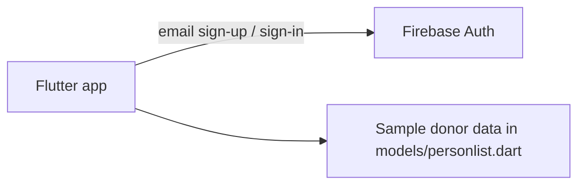

<div align="center">

# Blood Sphere

A Flutter mobile app prototype that connects blood donors with people who need blood, using Firebase Authentication for accounts.


</div>

> Team hackathon project. Status: early prototype. Sign-up and sign-in work against Firebase. The donor list and search are UI with sample data.

## Why we built it

During COVID-19 in Nepal, a close friend was hospitalized and his doctor asked his family to bring AB+ blood. Finding the right blood group took the family and their friends several failed attempts and a long time. That experience led our team to design an app where donors and recipients can find each other quickly by blood group and location, especially in places that face shortages of suitable blood types and donors.

## Features

- **Onboarding**: a swipeable splash carousel ("Once a blood donor, always a lifesaver!") with a "Ready To Donate?" call to action.
- **Email sign-up**: `createUserWithEmailAndPassword` through Firebase Auth, with form validation and a progress overlay (`modal_progress_hud_nsn`).
- **Email sign-in**: `signInWithEmailAndPassword`, then a login success screen that leads to Home.
- **Home**: header with a donor search field, a "Donate Blood Save Life!" banner, and a "Donors Near You" list of cards.
- **Donor details**: tapping a card opens a detail screen with the donor's photo, name and description, including blood group.
- **Navigation**: bottom navigation bar between Home and Profile, and a forgot-password form.
- **Theming**: red primary color and the Muli font family, bundled under `assets/fonts/muli/`.

## Tech stack

| Layer | Technology |
| --- | --- |
| Framework | Flutter (Dart SDK `>=2.17.6 <3.0.0`) |
| Auth | Firebase Core, Firebase Auth |
| Data | `cloud_firestore` (declared, not yet used in code) |
| State and UI | `provider` (declared), `flutter_svg`, `modal_progress_hud_nsn` |
| Platforms | Android, iOS, web, macOS, Windows and Linux runners generated by Flutter |

## Architecture



## Project structure

```text
lib/
├── main.dart                 # Firebase.initializeApp, MaterialApp
├── routes.dart               # named routes
├── theme.dart, constants.dart, size_config.dart
├── models/
│   └── personlist.dart       # Person model + sample donors
├── components/               # buttons, form errors, donor card, bottom nav
└── screens/
    ├── splash/               # onboarding (PromptScreen)
    ├── sign_in/  sign_up/  forgot_password/  login_success/
    ├── home/                 # header, search field, banner, donor list
    ├── details/              # donor detail view
    └── profile/
assets/
├── fonts/muli/
├── icons/
└── images/
```

## Getting started

### Prerequisites

- Flutter SDK compatible with Dart 2.17 (Flutter 3.0 to 3.x before Dart 3)
- A Firebase project with **Email/Password** sign-in enabled

### Configure Firebase

- **Android**: the app expects `android/app/google-services.json` (applied with the `com.google.gms.google-services` plugin). Replace it with the config file from your own Firebase project.
- **iOS**: add your `GoogleService-Info.plist` to `ios/Runner/`. It is not included in the repo.

### Run

```bash
flutter pub get
flutter run
```

## Limitations

- Donors are five hardcoded sample entries. Firestore is a dependency but nothing reads from or writes to it yet.
- The search field only prints input to the console, and there is no location-based matching yet.
- The forgot-password "Continue" button and the "Sign in with" social button have empty handlers. Google sign-in is not implemented.
- The profile screen shows only a profile picture.
- Parts of the UI were adapted from an e-commerce Flutter template. Names such as `ProductCard` and `Cart`, and sample product images in `assets/images/`, are still present.
- `android/app/google-services.json` is committed. Firebase client config is not a secret, but restrict the API key and lock down Firebase security rules before real use.

## What we learned

The team split frontend and backend work. The hardest parts were integrating the Flutter frontend with Firebase and making core actions reachable in a single tap. Along the way we learned how to add Firebase to a Flutter app and implement user authentication.

---

Built by [Abhishek Yadav](https://github.com/abhiishek340) and hackathon teammates
